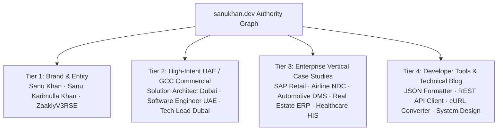

# SEO & Keyword Optimization Guide — `sanukhan.dev`

> [!IMPORTANT]
> **Golden Rule of Keyword Optimization:** Every indexable URL on `sanukhan.dev` must own **one primary search intent** (1 primary keyword + 3–5 semantic secondary keywords). Never target the exact same primary keyword across multiple pages to avoid **keyword cannibalization**.

---

## 1. Keyword Architecture & Search Intent Tiers

| Tier | Intent Type | Target Audience | Conversion Goal |
| :--- | :--- | :--- | :--- |
| **Tier 1: Brand & Entity** | Navigational | Recruiters, CTOs, clients searching your name or brand directly | Establish `#1` Google Knowledge Graph panel & sitelinks |
| **Tier 2: Commercial Geo (UAE / GCC)** | Transactional / Hiring | Enterprise hiring managers, VPs of Engineering, founders in Dubai/UAE/KSA | Direct inquiries via `/contact` or LinkedIn |
| **Tier 3: Enterprise Architecture Case Studies** | Commercial Investigation | Architects & technical leads evaluating real-world domain experience | Proof of architecture depth (`SAP`, `NDC`, `Kafka`, `Azure`) |
| **Tier 4: Developer Tools & Engineering Notes** | Informational / Utility | Global engineers searching for tools, system design, or Node.js/JS guides | Backlinks, repeat traffic, and domain authority (`DR`) |

---

## 2. Route-by-Route Keyword Mapping Matrix (Anti-Cannibalization Map)

Use this map when updating existing pages or adding new ones so each URL owns a distinct keyword cluster:

### 2.1 Core Brand & Portfolio Pages
| Route | Primary Keyword | Secondary / Semantic Keywords | Target Title Formula |
| :--- | :--- | :--- | :--- |
| `/` | `Solution Architect Dubai` / `Sanu Khan` | `Tech Lead Dubai`, `Software Engineer Dubai`, `Enterprise Integration Architect UAE`, `Sanu Karimulla Khan` | `Sanu Khan \| Solution Architect, Tech Lead & Software Engineer in Dubai, UAE` |
| `/about` | `Sanu Khan` / `Sanu Karimulla Khan` | `Solution Architect & Engineering Leader Dubai`, `Al-Futtaim Architect`, `TechCarrot Tech Lead` | `About Sanu Khan \| Solution Architect & Engineering Leader in Dubai, UAE` |
| `/projects` | `Enterprise Architecture Case Studies` | `Solution Architect Portfolio Dubai`, `Production Engineering Case Studies UAE` | `Enterprise Architecture & Software Engineering Case Studies \| Sanu Khan` |
| `/contact` | `Hire Solution Architect Dubai` | `Contact Sanu Khan`, `Hire Tech Lead UAE`, `Full Stack Consultant Inquiry Dubai` | `Contact Sanu Khan \| Hire Solution Architect & Tech Lead in Dubai, UAE` |
| `/faq` | `Solution Architect Dubai FAQ` | `Enterprise Integration Consulting Questions UAE`, `Software Engineering Leadership FAQ` | `Engineering & Architecture FAQ \| Sanu Khan — Solution Architect Dubai` |

### 2.2 High-Intent UAE Commercial Service Pages
| Route | Primary Keyword | Secondary / Semantic Keywords |
| :--- | :--- | :--- |
| `/software-engineer-uae` | `Senior Software Engineer UAE` | `Software Engineer Dubai`, `Principal Software Engineer UAE`, `Cloud Microservices Engineer Dubai` |
| `/full-stack-consultant-uae` | `Full-Stack Consultant UAE` | `Full Stack Architect Dubai`, `Technical Lead Consultant UAE`, `React Node.js Consultant Dubai` |
| `/api-integration-services` | `API Integration Services UAE` | `SAP ERP Integration Dubai`, `Shopify Kibo Integration UAE`, `Event-Driven Middleware Architect` |
| `/nodejs-developer-uae` | `Senior Node.js Developer UAE` | `Node.js Backend Architect Dubai`, `TypeScript NestJS Microservices UAE`, `High-Throughput API Engineer` |
| `/react-developer-dubai` | `Senior React Developer Dubai` | `Next.js Frontend Architect UAE`, `Bilingual RTL Web Applications Dubai`, `TypeScript UI Architect` |

### 2.3 Enterprise Case Studies (`/projects/*`)
| Route | Primary Keyword | Domain / Stack Keywords |
| :--- | :--- | :--- |
| `/projects/enterprise-retail-integration` | `Enterprise Retail SAP Integration` | `Event-Driven Retail Architecture`, `Order Management Orchestration`, `Shopify Kibo SAP Sync` |
| `/projects/airline-retailing-aggregation` | `Airline NDC Retailing Aggregation` | `NDC Offer Order Architecture`, `Aviation Middleware GDS LCC`, `High-Throughput Search Fan-Out` |
| `/projects/automotive-omnichannel-platform` | `Automotive Omnichannel Platform` | `Dealer Management System (DMS) Integration`, `Automotive Digital Retailing UAE`, `VIN Reservation API` |
| `/projects/real-estate-erp-architecture` | `Real Estate ERP Architecture UAE` | `Property & Leasing Lifecycle System`, `Multi-Entity Financial Reconciliation`, `Automated Billing ERP` |
| `/projects/garage-management-and-diagnostics` | `Garage Management System Architecture` | `Workshop Bay Scheduling Platform`, `Vehicle Telemetry Diagnostics`, `Automotive Aftersales System` |
| `/projects/headless-healthcare-digital-experience` | `Headless Healthcare Digital Experience` | `HIS EMR Integration Architecture`, `Patient Portal BFF Layer`, `Accessible Healthcare UX` |
| `/projects/zaakiy-v3rse` | `ZaakiyV3RSE` | `Bilingual LTR/RTL Engineering Portfolio`, `AI Portfolio Assistant Architecture`, `sanukhan.dev` |

### 2.4 Developer Tools (`/tools/*`)
| Route | Primary Keyword | Secondary Keywords |
| :--- | :--- | :--- |
| `/tools` | `Free Online Developer Tools` | `Privacy-First Browser Developer Utilities`, `Client-Side API & JSON Tools` |
| `/tools/json-formatter-online` | `JSON Formatter Online` | `JSON Validator Online`, `JSON Minifier & Beautifier`, `Private Browser JSON Debugger` |
| `/tools/api-client-tool` | `Online REST API Client` | `HTTP Request Tester Browser`, `Test REST API Online`, `Lightweight Postman Alternative` |
| `/tools/curl-to-json-converter` | `cURL to JSON Converter` | `cURL to JavaScript Fetch Converter`, `Parse cURL Command Online` |

---

## 3. On-Page Keyword Placement Checklist (For Every New Page or Post)

Whenever you publish a new case study, service page, or blog post, apply this **7-point placement formula**:

1. **`<title>` Tag (50–65 characters ideal)**
   - **Formula:** `[Primary Keyword & Value Proposition] | Sanu Khan`
   - **Rule:** Place the primary keyword within the **first 40 characters**. Always end with `| Sanu Khan` to reinforce brand entity association.
2. **`<meta name="description">` (140–165 characters ideal)**
   - **Formula:** `[Action/Role + Primary Keyword] + [Proof/Metrics: 13+ years, Dubai UAE] + [Key Technologies/Domains].`
   - **Rule:** Include 1 primary keyword, 2 secondary keywords, and a geographic/credibility hook (`Dubai, UAE`, `13+ years`).
3. **URL Slug (`canonicalPath`)**
   - **Rule:** Short, lowercase, hyphen-separated (`3–5` words max), matching the primary topic (e.g., `/blog/nodejs-api-best-practices`). Never change existing URLs without a `301` redirect in [`vercel.json`](file:///C:/Users/SanuKarimullaKhan/projects/sanukhandev.github.io/vercel.json).
4. **Single `<h1>` Heading**
   - **Rule:** Every page must have **exactly one `<h1>`** containing the primary keyword or its close semantic variant.
5. **First 100 Words (Lead Paragraph)**
   - **Rule:** Mention the primary keyword, domain context, and entity name (`Sanu Khan`) naturally in the opening summary paragraph.
6. **`<h2>` & `<h3>` Subheadings**
   - **Rule:** Use secondary and long-tail keywords in `<h2>` subheadings (e.g., *"Event-Driven Integration & Anti-Corruption Layer"* instead of generic *"Overview"*).
7. **Internal Anchor Text**
   - **Rule:** Link between related pages using descriptive keyword anchor text (e.g., link from a blog post about API gateways to [`/api-integration-services`](file:///C:/Users/SanuKarimullaKhan/projects/sanukhandev.github.io/src/pages/services/ApiIntegrationServicesPage.tsx) using anchor text *"enterprise API integration architecture"* instead of *"click here"*).

---

## 4. Bilingual (English LTR + Arabic RTL) Keyword Strategy

Because `sanukhan.dev` supports both English (`en`) and Arabic (`ar` via `?lang=ar` with `hreflang="ar"` in [`src/components/SeoMeta.tsx`](file:///C:/Users/SanuKarimullaKhan/projects/sanukhandev.github.io/src/components/SeoMeta.tsx) and [`public/sitemap.xml`](file:///C:/Users/SanuKarimullaKhan/projects/sanukhandev.github.io/public/sitemap.xml)):

> [!TIP]
> **High-Value Arabic Keywords (`ar-AE` / `ar-SA`):** Competition for Arabic enterprise architecture queries in Dubai and Riyadh is significantly lower than English.

- **Brand Entity:** `سانو خان` (`Sanu Khan`)
- **Role Keywords:**
  - `معماري حلول برمجية دبي` (*Solution Architect Dubai*)
  - `مهندس برمجيات في دبي` (*Software Engineer in Dubai*)
  - `قائد تقني الإمارات` (*Tech Lead UAE*)
  - `خبير تقني وتكامل الأنظمة` (*Technical Expert & Systems Integration*)
  - `تكامل أنظمة SAP والسحابة` (*SAP & Cloud Systems Integration*)
- **Rule:** Keep technical acronyms (`SAP`, `AWS`, `Azure`, `Kafka`, `Node.js`, `React`, `API`) in Latin script inside Arabic sentences, wrapped naturally so bidirectional search queries match cleanly.

---

## 5. Content Syndication & Off-Page Authority Rules (Dev.to, Medium, LinkedIn, GitHub)

To make `sanukhan.dev` outrank third-party platforms for your own articles and name:

1. **Set `canonical_url` on Dev.to & Medium:**
   - Whenever you publish an article on `dev.to/sanukhandev` or Medium, set the article's `canonical_url` in frontmatter/settings to `https://www.sanukhan.dev/blog/<slug>`.
   - Because [`scripts/prerender-routes.mjs`](file:///C:/Users/SanuKarimullaKhan/projects/sanukhandev.github.io/scripts/prerender-routes.mjs) automatically generates static HTML for every Dev.to article on `npm run build`, Google will credit **100% of the ranking authority to `www.sanukhan.dev`**.
2. **Exact Entity Consistency Across Profiles (`sameAs` Graph):**
   - Keep your headline on **LinkedIn, GitHub, Dev.to, Stack Overflow, Medium, and X** aligned with your core entity keywords:
     > **Sanu Khan (Sanu Karimulla Khan)** — *Solution Architect, Tech Lead & Senior Software Engineer | Dubai, UAE | Enterprise Integration (SAP, Cloud, Microservices) · sanukhan.dev*
3. **Register New Static Routes in Both Build Scripts:**
   - Whenever you add a new static route in [`src/App.tsx`](file:///C:/Users/SanuKarimullaKhan/projects/sanukhandev.github.io/src/App.tsx), add its route entry to:
     - [`scripts/generate-sitemap.mjs`](file:///C:/Users/SanuKarimullaKhan/projects/sanukhandev.github.io/scripts/generate-sitemap.mjs)
     - [`scripts/prerender-routes.mjs`](file:///C:/Users/SanuKarimullaKhan/projects/sanukhandev.github.io/scripts/prerender-routes.mjs)

---

## 6. 30-Day Google Search Console (GSC) Execution Playbook

| Week | Action | Target Metric |
| :--- | :--- | :--- |
| **Day 1** | Submit `https://www.sanukhan.dev/sitemap.xml` in Google Search Console & Bing Webmaster Tools. Request indexing for `/`, `/about`, `/projects`, and all 5 UAE service pages. | All 46 sitemap URLs discovered with `200 OK` and matching canonicals |
| **Day 7** | Check **GSC → Pages → Why pages aren't indexed**. Verify that *"Duplicate, Google chose different canonical"* drops to `0` now that static route prerendering is live. | `40+` indexed pages in GSC |
| **Day 14** | Review **GSC → Performance → Search results** filtered by queries containing `dubai`, `uae`, `architect`, `sanu`. Identify queries ranking in positions `8–20`. | Baseline impressions & average position per route |
| **Day 21** | For pages ranking in positions `8–20`, add the exact query phrasing from GSC into an `<h2>`, FAQ item, or case study bullet on that specific route. | Push position `8–20` queries into Top 3 (`CTR > 5%`) |
| **Day 30** | Publish 1 new architecture deep-dive on Dev.to (with `canonical_url` pointing to `sanukhan.dev/blog/<slug>`) and trigger a production deploy so `prerender-routes.mjs` builds its static page. | Compounding organic growth + AI answer engine citations |
